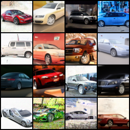
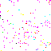
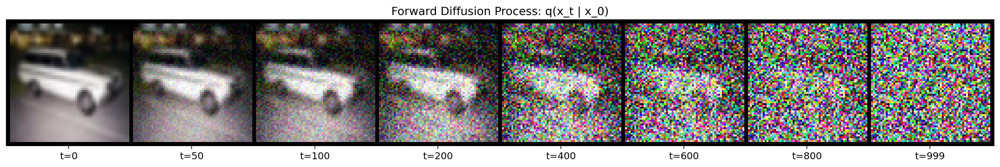
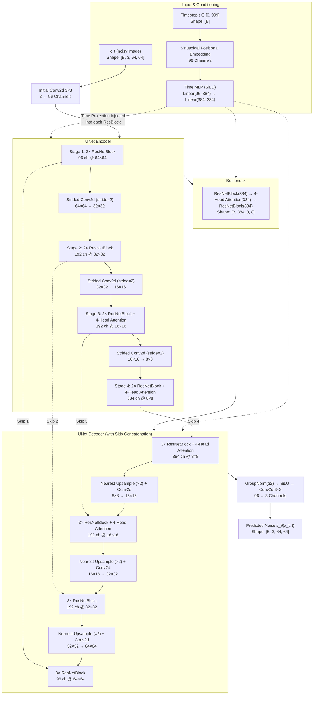
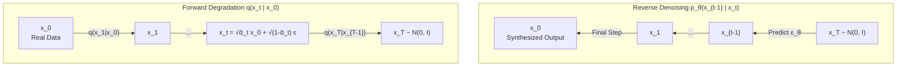
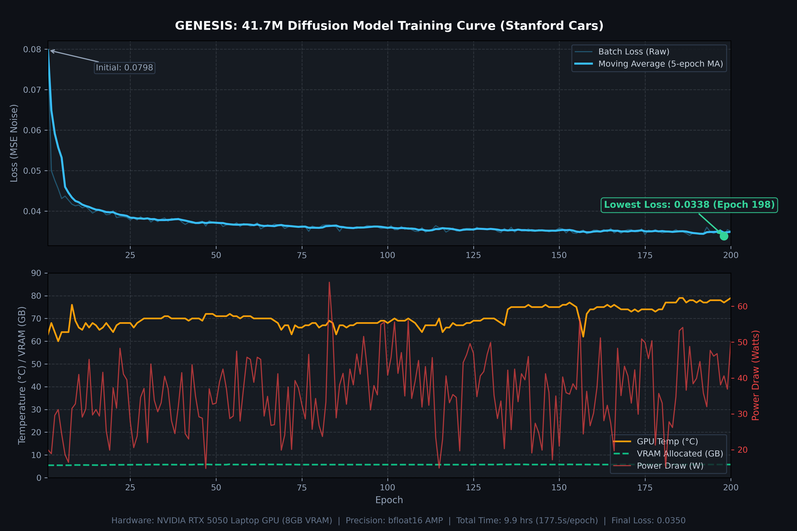

<div align="center">

# GENESIS

### Unconditional Deep Diffusion Model for Vehicle Synthesis

[](https://python.org)
[](https://pytorch.org)
[](https://developer.nvidia.com/cuda-toolkit)
[](https://github.com)
[-76B900?style=flat-square)](https://nvidia.com)
[](LICENSE)

<p align="center">
  A clean-room implementation of Denoising Diffusion Probabilistic Models (DDPM) and Denoising Diffusion Implicit Models (DDIM) in pure PyTorch.<br>
  Trained for 200 epochs across 16,185 images from the Stanford Cars dataset to synthesize coherent vehicle structures from Gaussian noise.
</p>

---

</div>

## Visual Showcase

<div align="center">

### Generated Sample Grid (200 Epochs, EMA Weights, DDIM-75)



*Curated 4×4 generation grid from the 200-epoch EMA checkpoint. Every sample is synthesized starting from pure standard normal noise $\mathbf{x}_T \sim \mathcal{N}(\mathbf{0}, \mathbf{I})$.*

</div>

<br>

<table align="center" width="100%">
<tr>
<td width="50%" align="center">
<b>50-Step DDIM Reverse Denoising (x_T &rarr; x_0)</b>
<br><br>

<br>
<em>Trajectory of estimated clean image across 50 accelerated implicit sampling timesteps.</em>
</td>
<td width="50%" align="center">
<b>Latent Spherical Linear Interpolation (SLERP)</b>
<br><br>

<br>
<em>Smooth geodesic interpolation between two distinct Gaussian noise vectors on the latent hypersphere.</em>
</td>
</tr>
</table>

<br>

<div align="center">

### Forward Diffusion Process: q(x_t | x_0)



*Stepwise Gaussian noise corruption across T = 1000 steps using the Nichol & Dhariwal cosine schedule.*

</div>

---

## Technical Highlights

- **Pure PyTorch Implementation**: Built without external diffusion frameworks (no Diffusers, no pre-trained weights). Every module—from sinusoidal positional embeddings and multi-head spatial attention to the non-Markovian DDIM sampler—is written from scratch.
- **Cosine Noise Schedule**: Avoids the rapid entropy collapse of linear schedules near $t=0$ by adopting an offset cosine decay ($s=0.008$), preserving structural signal across higher timesteps.
- **Dual Sampling Engines**:
  - **DDPM (Ho et al.)**: 1,000-step stochastic Markovian reverse process.
  - **DDIM (Song et al.)**: 50–100 step accelerated non-Markovian deterministic sampler ($\eta=0$), providing a 20× speedup with zero structural regression.
- **Hardware Telemetry & Optimization**: Built-in `pynvml` instrumentation capturing instantaneous GPU utilization, VRAM allocation, temperature, and power consumption directly to CSV every epoch. Trained with `bfloat16` automatic mixed precision (AMP) and TF32 matrix multiplication.
- **Built-in Quantitative Evaluation**: Features an integrated Fréchet Inception Distance (FID) computation pipeline utilizing an Inception-V3 backbone with manual covariance matrix square-root calculation via `scipy`.

---

## System Architecture



### Layer Dimensionality Specification

| Stage | Operation | Resolution | Channels | Attention | Skip Target |
|:---|:---|:---:|:---:|:---:|:---:|
| **Input** | Clean RGB Image $\mathbf{x}_0$ | $64 \times 64$ | 3 | — | — |
| **Initial** | Conv2d $3 \times 3$ | $64 \times 64$ | 96 | No | — |
| **Enc Stage 1** | $2 \times$ ResBlock | $64 \times 64$ | 96 | No | Skip 1 |
| **Enc Stage 2** | Downsample + $2 \times$ ResBlock | $32 \times 32$ | 192 | No | Skip 2 |
| **Enc Stage 3** | Downsample + $2 \times$ ResBlock + Attn | $16 \times 16$ | 192 | **Yes (4 heads)** | Skip 3 |
| **Enc Stage 4** | Downsample + $2 \times$ ResBlock + Attn | $8 \times 8$ | 384 | **Yes (4 heads)** | Skip 4 |
| **Bottleneck** | ResBlock + Attn + ResBlock | $8 \times 8$ | 384 | **Yes (4 heads)** | — |
| **Dec Stage 4** | $3 \times$ ResBlock + Attn | $8 \times 8$ | 384 | **Yes (4 heads)** | Concat Skip 4 |
| **Dec Stage 3** | Upsample + $3 \times$ ResBlock + Attn | $16 \times 16$ | 192 | **Yes (4 heads)** | Concat Skip 3 |
| **Dec Stage 2** | Upsample + $3 \times$ ResBlock | $32 \times 32$ | 192 | No | Concat Skip 2 |
| **Dec Stage 1** | Upsample + $3 \times$ ResBlock | $64 \times 64$ | 96 | No | Concat Skip 1 |
| **Output** | GroupNorm + SiLU + Conv2d $3 \times 3$ | $64 \times 64$ | 3 | — | Output $\hat{\boldsymbol{\epsilon}}$ |

---

## Mathematical Formulation



### 1. Forward Noising Process

Given a clean input image $\mathbf{x}_0$, the forward Markov chain progressively corrupts the structure by adding Gaussian noise over $T = 1000$ discrete timesteps:

$$
q(\mathbf{x}_t \mid \mathbf{x}_{t-1}) = \mathcal{N}\left(\mathbf{x}_t;\, \sqrt{1 - \beta_t}\,\mathbf{x}_{t-1},\; \beta_t\mathbf{I}\right)
$$

By defining $\alpha_t = 1 - \beta_t$ and $\bar{\alpha}_t = \prod_{s=1}^t \alpha_s$, the forward marginal distribution can be computed directly in closed form without recursive sampling:

$$
q(\mathbf{x}_t \mid \mathbf{x}_0) = \mathcal{N}\left(\mathbf{x}_t;\, \sqrt{\bar{\alpha}_t}\,\mathbf{x}_0,\; (1 - \bar{\alpha}_t)\mathbf{I}\right)
$$

$$
\mathbf{x}_t = \sqrt{\bar{\alpha}_t}\,\mathbf{x}_0 + \sqrt{1 - \bar{\alpha}_t}\,\boldsymbol{\epsilon}, \quad \boldsymbol{\epsilon} \sim \mathcal{N}(\mathbf{0}, \mathbf{I})
$$

We adopt the **cosine variance schedule** (Nichol & Dhariwal, 2021) with offset $s = 0.008$ to preserve structural information longer across intermediate timesteps:

$$
\bar{\alpha}_t = \frac{f(t)}{f(0)}, \quad f(t) = \cos\left(\frac{t/T + s}{1 + s} \cdot \frac{\pi}{2}\right)^2
$$

### 2. Optimization Objective

Rather than predicting the clean image $\mathbf{x}_0$ directly, the neural network $\boldsymbol{\epsilon}_\theta(\mathbf{x}_t, t)$ is parameterized to estimate the random noise vector $\boldsymbol{\epsilon}$ added to the latent at timestep $t$. The loss is the mean squared error (MSE):

$$
\mathcal{L}_{\text{simple}}(\theta) = \mathbb{E}_{t, \mathbf{x}_0, \boldsymbol{\epsilon}}\left[\left\|\boldsymbol{\epsilon} - \boldsymbol{\epsilon}_\theta(\mathbf{x}_t, t)\right\|^2\right]
$$

### 3. Accelerated DDIM Reverse Step

While standard DDPM sampling requires running all $T = 1000$ sequential stochastic transitions, Denoising Diffusion Implicit Models (Song et al.) generalize the reverse process to non-Markovian inference. 

Setting the stochasticity parameter $\sigma_t = 0$ yields a deterministic ordinary differential equation (ODE) trajectory that can be integrated over a sub-sequence of 50 timesteps:

$$
\hat{\mathbf{x}}_0 = \frac{\mathbf{x}_t - \sqrt{1 - \bar{\alpha}_t}\,\boldsymbol{\epsilon}_\theta(\mathbf{x}_t, t)}{\sqrt{\bar{\alpha}_t}}
$$

$$
\mathbf{x}_{t-1} = \sqrt{\bar{\alpha}_{t-1}}\,\hat{\mathbf{x}}_0 + \sqrt{1 - \bar{\alpha}_{t-1}}\,\boldsymbol{\epsilon}_\theta(\mathbf{x}_t, t)
$$

---

## Empirical Training Performance

The complete 200-epoch training sequence was executed on a single laptop workstation without cluster dependencies.



### Run Statistics

| Metric | Measured Value |
|:---|:---|
| **Total Parameter Count** | 41,673,315 (~41.67M) |
| **Training Dataset** | Stanford Cars (16,185 images, cached in RAM as `.pt`) |
| **Batch Size & Precision** | 32 / `bfloat16` Automatic Mixed Precision (AMP) |
| **Completed Epochs** | 200 / 200 |
| **Initial Loss (Epoch 1)** | 0.0798 |
| **Final Loss (Epoch 200)** | 0.0350 |
| **Minimum Recorded Loss** | **0.0338** (Epoch 198, **-57.6% relative drop**) |
| **Total Wall-Clock Time** | 35,214 seconds (~9.78 hours) |
| **Mean Iteration Speed** | 176.1 seconds / epoch |
| **Allocated GPU Memory** | 5.48 GB initial &rarr; 5.80 GB steady (out of 7.96 GB VRAM) |
| **Peak GPU Operating Temp** | 79°C |
| **Steady Power Draw** | 36.9W – 50.2W |

---

## Repository Structure

```
GENESIS/
├── train.py              # Main training loop (AMP, EMA, GPU telemetry, preview hook)
├── model.py              # Parametric UNet, Sinusoidal embeddings, 4-Head Attention
├── diffusion.py          # Gaussian diffusion math, noise schedules, MSE objective
├── data.py               # Stanford Cars auto-fetch, center-crop, RAM cache, DataLoader
├── sample.py             # DDPM & DDIM inference engine + built-in FID evaluator
├── interpolate.py        # Latent space SLERP morphing & step-by-step denoising GIF
├── SOURCES.md            # Canonical paper references & dataset acknowledgements
├── .gitignore            # Clean repository filtering (excludes data & heavy .pt weights)
│
├── checkpoints/
│   ├── loss_log.csv      # Complete 200-epoch loss & telemetry log (tracked)
│   ├── latest.pt         # Full checkpoint with model, EMA shadow, & optimizer state
│   └── epoch_XXX.pt      # Periodic snapshots saved every 25 epochs
│
└── progress/
    ├── epochs001-200.png      # High-fidelity 4×4 generation grid
    ├── car_hero.png           # Spotlight standalone car generation
    ├── car_generation.gif     # 50-step denoising process animation
    ├── car_morph.gif          # Latent space SLERP interpolation animation
    └── training_metrics.png   # Dual-panel 300 DPI loss & GPU telemetry chart
```

---

## Quickstart

### 1. Installation
Clone the repository and install the minimal runtime dependencies:
```bash
git clone https://github.com/<your-username>/GENESIS.git
cd GENESIS
pip install torch torchvision pillow matplotlib tqdm pynvml scipy
```

### 2. Synthesize Cars (Inference)
Generate a 16-sample grid from the trained EMA checkpoint in seconds:
```bash
# High-speed deterministic sampling via DDIM (50 steps)
python sample.py --method ddim --steps 50 --samples 16

# Full 1000-step stochastic sampling via DDPM
python sample.py --method ddpm --samples 16

# Compute Fréchet Inception Distance (FID) over 500 samples
python sample.py --eval_fid --fid_samples 500
```

### 3. Latent Space Explorations & Animations
Generate visual animations showing either the noise-to-car emergence or smooth interpolation:
```bash
# Generate spherical latent interpolation animation
python interpolate.py --mode morph --frames 36 --hold 20

# Generate step-by-step denoising trajectory animation
python interpolate.py --mode denoise --steps 50 --hold 30
```

### 4. Training from Scratch
To initiate model training with custom parameters:
```bash
python train.py \
  --dataset stanford_cars \
  --image_size 64 \
  --batch_size 32 \
  --epochs 200 \
  --lr 2e-4 \
  --schedule cosine \
  --ema_decay 0.9999 \
  --sample_every 10 \
  --save_every 25
```

---

## References

1. **Denoising Diffusion Probabilistic Models**  
   *Jonathan Ho, Ajay Jain, Pieter Abbeel (NeurIPS 2020)* — [arXiv:2006.11239](https://arxiv.org/abs/2006.11239)
2. **Improved Denoising Diffusion Probabilistic Models**  
   *Alex Nichol, Prafulla Dhariwal (ICML 2021)* — [arXiv:2102.09672](https://arxiv.org/abs/2102.09672)
3. **Denoising Diffusion Implicit Models**  
   *Jiaming Song, Chenlin Meng, Stefano Ermon (ICLR 2021)* — [arXiv:2010.02502](https://arxiv.org/abs/2010.02502)
4. **Diffusion Models Beat GANs on Image Synthesis**  
   *Prafulla Dhariwal, Alex Nichol (NeurIPS 2021)* — [arXiv:2105.05233](https://arxiv.org/abs/2105.05233)
5. **3D Object Representations for Fine-Grained Categorization (Stanford Cars)**  
   *Jonathan Krause, Michael Stark, Jia Deng, Li Fei-Fei (ICCV Workshops 2013)* — [Stanford AI Lab](https://ai.stanford.edu/~jkrause/cars/car_dataset.html)

---

## License

This project is licensed under the MIT License. The Stanford Cars dataset is intended for non-commercial academic research.
