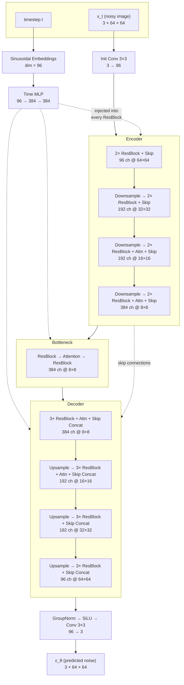
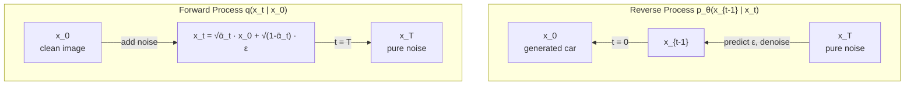
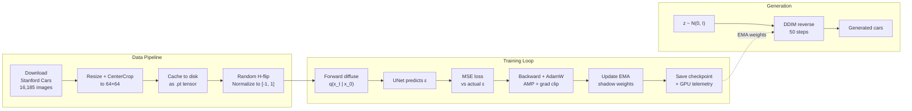
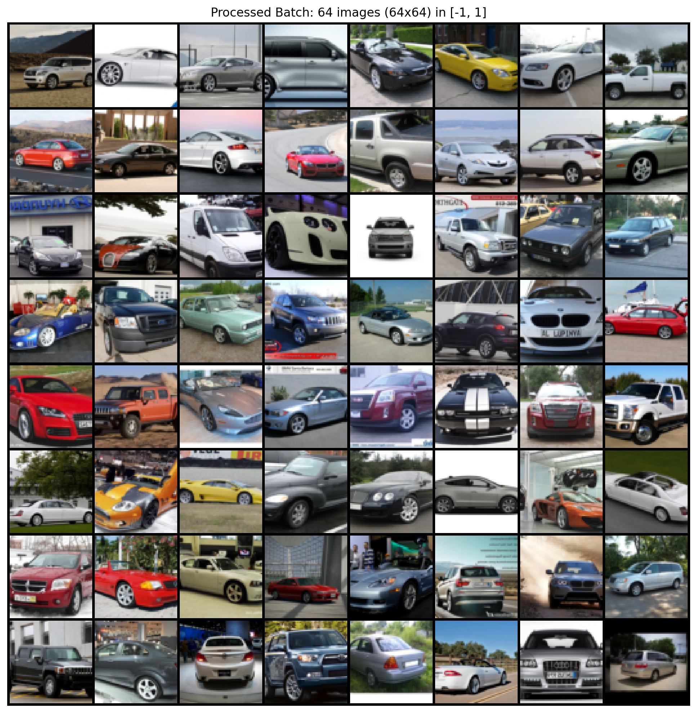

# GENESIS

**A diffusion model that learns to generate cars from pure noise.**

Implements the core DDPM/DDIM papers from scratch in PyTorch — a 41.67M parameter UNet trained on 16,185 images from the Stanford Cars dataset.


*16 cars that don't exist. Every pixel came from Gaussian noise.*

---

## What this actually does

The model learns two things:
1. **How to destroy an image** — progressively add Gaussian noise until it's static (forward process)
2. **How to undo that destruction** — predict and remove the noise at each step (reverse process)

Once trained, you throw pure random noise at the reverse process and a car materializes out of it.


*A real car from the dataset being destroyed over 1000 timesteps. The model learns to reverse this.*

<br>

### Noise to car in 50 steps (DDIM)


### Morphing between two cars via latent space interpolation


---

## Architecture

The backbone is a UNet conditioned on diffusion timestep. Nothing exotic — ResBlocks, skip connections, multi-head self-attention at the lower spatial resolutions where it actually matters, and sinusoidal position embeddings to tell the network *when* in the noise schedule it is.

```
UNet — 41.67M parameters
├── base_channels:   96
├── channel_mults:   (1, 2, 2, 4) → 96 / 192 / 192 / 384
├── attention:       4-head self-attention at 16×16 and 8×8
├── res_blocks:      2 per encoder level, 3 per decoder level
├── time_embedding:  sinusoidal(96) → MLP → 384-dim
├── normalization:   GroupNorm(32)
├── activation:      SiLU throughout
├── downsample:      strided 3×3 conv (stride 2)
└── upsample:        nearest interpolation ×2 → 3×3 conv
```



The skip connections concatenate encoder features with decoder features at matching resolutions. Attention only fires at 16×16 and 8×8 — at higher resolutions it would torch the VRAM for minimal benefit.

---

## The Diffusion Math

Two noise schedules are implemented. Training uses the **cosine schedule** (Nichol & Dhariwal, 2021) which avoids the too-fast noise saturation of the linear schedule.



| Component | Detail |
|:---|:---|
| Timesteps | T = 1000 |
| β schedule | Cosine (s = 0.008), clipped to [0.0001, 0.9999] |
| Forward | q(x_t \| x_0) = N(√ᾱ_t · x_0, (1 − ᾱ_t) · I) |
| Training objective | L = E[‖ε − ε_θ(x_t, t)‖²] — simple MSE noise prediction |
| DDPM sampling | Full 1000-step reverse with posterior variance |
| DDIM sampling | Accelerated 50-step deterministic (η = 0) |

---

## Training

### Hardware
- **GPU**: NVIDIA RTX 5050 Laptop GPU (8 GB VRAM)
- **Precision**: bfloat16 mixed precision (AMP)
- **CUDA**: 12.8 / PyTorch 2.11
- **Optimizations**: cuDNN benchmark, TF32 matmul, gradient clipping (max_norm=1.0)

### Hyperparameters
| | |
|:---|:---|
| Optimizer | AdamW (lr = 2e-4, weight_decay = 1e-4) |
| Batch size | 32 |
| EMA decay | 0.9999 |
| Epochs | 200 |
| Gradient clipping | max_norm = 1.0 |

### Results

| Metric | Value |
|:---|:---|
| Initial loss (epoch 1) | 0.0798 |
| Final loss (epoch 200) | 0.0350 |
| Best loss (epoch 198) | **0.0338** |
| Total training time | 9.8 hours |
| Avg time per epoch | ~176 seconds |
| Steady-state VRAM | 5.8 / 7.96 GB |
| Peak GPU temp | 79°C |

The loss drops fast in the first ~25 epochs (learning the coarse structure), then slowly grinds down as the model picks up finer details. Most of the meaningful learning happens early — the last 100 epochs are about texture and edge quality.


*Loss curve with 5-epoch moving average + GPU telemetry (temperature, VRAM, power draw).*

### What the model learns over time

The training script drops preview samples every 10 epochs. Early on it's blurry color blobs. By epoch 50 you start seeing car-shaped things. By 200 the details tighten up — windshields, wheels, headlights emerge. It's not photorealistic at 64×64, but the structure is learned.

---

## Sampling

Two sampling modes are available:

**DDPM** — the original 1000-step stochastic sampler. Faithful to the math but slow (~40 seconds per batch on the 5050).

**DDIM** — deterministic 50-step sampler. Same quality, 20× faster. This is what the training previews use.

```bash
# generate 16 cars using DDIM (default, recommended)
python sample.py --method ddim --steps 50 --samples 16

# full DDPM sampling (slow, 1000 steps)
python sample.py --method ddpm --samples 16

# evaluate FID score against real dataset
python sample.py --eval_fid --fid_samples 500
```

FID evaluation is built in — it spins up InceptionV3, extracts features from real and generated images, and computes the Fréchet distance. No external libraries needed beyond scipy.

---

## Latent Space Exploration

The model learns a smooth, continuous latent space. Two noise vectors that are "close" in this space produce similar-looking cars. SLERP (spherical linear interpolation) along the surface of the noise hypersphere lets you morph between any two generated cars smoothly.

```bash
# morph between two random cars
python interpolate.py --mode morph --frames 30

# watch noise become a car (denoising visualization)
python interpolate.py --mode denoise --steps 50
```

---

## Pipeline



---

## Dataset

**Stanford Cars** (Krause et al.) — 16,185 images across 196 car classes. Sedans, SUVs, coupes, trucks, everything. The class labels aren't used here since this is unconditional generation — the model just learns "what cars look like" without caring about make or model.

Images are center-cropped to 64×64 and cached as a single PyTorch tensor on first run. The entire dataset lives in RAM during training (~600 MB), which makes the DataLoader fast since there's no disk I/O per batch.


*Random batch from the preprocessed training data.*

---

## Project Structure

```
GENESIS/
├── train.py             training loop — AMP, EMA, GPU telemetry, DDIM previews
├── model.py             UNet with multi-head attention and sinusoidal embeddings
├── diffusion.py         forward process, noise schedules, MSE loss
├── data.py              Stanford Cars download, preprocessing, caching
├── sample.py            DDPM / DDIM sampling + FID evaluation
├── interpolate.py       latent SLERP morphing + denoising animations
├── SOURCES.md           paper references and dataset citations
│
├── checkpoints/
│   ├── loss_log.csv     per-epoch loss + GPU stats (tracked in git)
│   ├── latest.pt        most recent weights
│   └── epoch_XXX.pt     periodic snapshots every 25 epochs
│
├── progress/
│   ├── epochs001-200.png      final generated grid
│   ├── car_generation.gif     noise-to-car animation
│   ├── car_morph.gif          latent interpolation
│   └── training_metrics.png   loss + hardware telemetry chart
│
└── data/                Stanford Cars download + .pt cache (gitignored)
```

---

## Quick Start

```bash
# install dependencies
pip install torch torchvision pillow matplotlib tqdm pynvml scipy

# download dataset + train (takes ~10 hours on an 8GB laptop GPU)
python train.py --epochs 200 --batch_size 32 --schedule cosine

# resume interrupted training
python train.py --resume

# generate cars from trained model
python sample.py --method ddim --samples 16

# create a morph animation
python interpolate.py --mode morph

# create a noise-to-car animation
python interpolate.py --mode denoise
```

To train at 128×128 (needs more VRAM and patience):
```bash
python train.py --image_size 128 --batch_size 16 --epochs 400
```

---

## Papers

This implementation draws from:

- Ho, Jain, Abbeel — [Denoising Diffusion Probabilistic Models](https://arxiv.org/abs/2006.11239) (DDPM)
- Nichol, Dhariwal — [Improved Denoising Diffusion Probabilistic Models](https://arxiv.org/abs/2102.09672) (cosine schedule)
- Song, Meng, Ermon — [Denoising Diffusion Implicit Models](https://arxiv.org/abs/2010.02502) (DDIM accelerated sampling)
- Dhariwal, Nichol — [Diffusion Models Beat GANs on Image Synthesis](https://arxiv.org/abs/2105.05233) (architecture choices)
- Heusel et al. — [GANs Trained by a Two Time-Scale Update Rule](https://arxiv.org/abs/1706.08500) (FID metric)

---

## License

This project uses the Stanford Cars dataset for non-commercial academic research. The code itself is MIT licensed.

